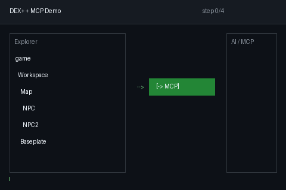

# roblox-DEXplusX5-AI-MCP

<p align="center">
  
</p>

<p align="center">
  <strong>DEX PlusPlusPlusPlus ↔ AI/MCP bidirectional bridge</strong><br/>
  <sub>Let Claude / Cursor read and write your DEX debugging session</sub>
</p>

<p align="center">
  
</p>

> **This fork adds AI/MCP bridge capability on top of upstream [DEX++ (snmwdd/DexPlusPlusPlusPlus)](https://github.com/snmwdd/DexPlusPlusPlusPlus).**

**English** · [中文](./README.md)

---

## Contents

- [What is this](#what-is-this)
- [Quick start](#quick-start)
- [Five forms](#five-forms)
- [Deploy](#deploy)
- [DEX API](#dex-api)
- [Troubleshooting](#troubleshooting)
- [Security](#security)
- [Upstream README](#upstream-readme)

---

## What is this

A Node.js MCP server + an executor-side Lua poller let Claude / Cursor read and write your DEX session: inspect selection, read properties, decompile scripts, set properties, execute Luau.

```
AI client (Claude / Cursor)
    |  MCP (stdio)
    v
Node.js server  :16384          <- local / Codespaces
    |  HTTP polling (150ms JSON)
    v
Roblox executor (Luau)
    script.lua = DEX++ + DexMCP
    dex_mcp_poller.lua -> getgenv().DEX
```

---

## Quick start

### 1. Start the server

```bash
git clone https://github.com/986mn/roblox-DEXplusX5-AI-MCP.git
cd roblox-DEXplusX5-AI-MCP
bash oneshot.sh
```

One command: install → compile → start → print loader code.

### 2. Load in executor

```lua
getgenv().BridgeURL = "localhost:16384"  -- or LAN IP / Codespaces https URL

loadstring(game:HttpGet(
  "https://raw.githubusercontent.com/986mn/roblox-DEXplusX5-AI-MCP/main/script.lua"
))()

loadstring(game:HttpGet(
  "https://raw.githubusercontent.com/986mn/roblox-DEXplusX5-AI-MCP/main/dex_mcp_poller.lua"
))()
```

See `[DPP-MCP] injected` and `[DPP-POLL] connected` and you are live.

---

## Five forms

| Form | Contents | Use |
|---|---|---|
| **A** | full read/write API | API only |
| **C** | floating button + queue | UI only |
| **AC** | A + C merged | full, recommended |
| **B** | runtime wrapper (incl. A) | official DEX |
| **BC** | B + C | official DEX + button |

```lua
-- AC merged single file (API + button)
loadstring(game:HttpGet(".../dex_mcp_AC.lua"))()

-- BC (official DEX + button)
getgenv().DEX_URL = "https://raw.githubusercontent.com/snmwdd/DexPlusPlusPlusPlus/refs/heads/main/script.lua"
loadstring(game:HttpGet(".../dex_mcp_BC.lua"))()
```

---

## Deploy

### Option 1: GitHub Codespaces

Open repo → Code → Codespaces → Create codespace on main. The container auto-runs npm install → tsc → start → set port public → keepalive.

Then copy the printed URL into your executor:

```lua
getgenv().BridgeURL = "https://xxxxx-16384.app.github.dev"
```

**Two things that must be right:**

1. **Port must be public** — Roblox executors carry no GitHub session; a private port shows a login page.
2. **https prefix is mandatory** — Codespaces only serves HTTPS. If your executor lacks TLS, use LAN instead.

**Woke up and the service is gone?** `postStart` does not reliably re-run on wake. Run:

```bash
bash .devcontainer/ensure-running.sh
```

**12-hour hard cap** — free Codespaces have a hard 12-hour lifetime.

### Option 2: Local

```bash
cd server
npm install
npx tsc
node dist/index.js < /dev/zero
```

Executor: `getgenv().BridgeURL = "localhost:16384"`

### Option 3: LAN (recommended for mobile)

Server on PC, phone connects over Wi-Fi. Find PC IP, open firewall port 16384, then in the phone executor:

```lua
getgenv().BridgeURL = "192.168.1.100:16384"
```

### Connect AI clients

```json
{
  "mcpServers": {
    "dexplusx5": {
      "command": "node",
      "args": ["/abs/path/roblox-DEXplusX5-AI-MCP/server/dist/index.js"]
    }
  }
}
```

| Client | Config |
|---|---|
| Claude Desktop | `claude_desktop_config.json` |
| Cursor | `~/.cursor/mcp.json` |
| Windsurf | `~/.codeium/windsurf/mcp_config.json` |
| VS Code | `~/.vscode/mcp.json` |

---

## DEX API

```lua
local D = getgenv().DEX

-- read
D.Snapshot()                          -- current selection + state
D.Tree("game.Workspace", 3, 200)      -- instance tree
D.Props("game.Workspace.NPC")         -- properties/attributes/tags
D.Source("game.ReplicatedStorage.X")  -- decompile (6 modes)
D.Resolve("game.Workspace.NPC")       -- path -> Instance
D.BuildPath(obj)                      -- Instance -> path

-- write
D.Select({"game.Workspace.NPC"})      -- select (UI jumps)
D.Select({p1,p2}, true)               -- add to selection
D.SetProp(path, "Health", "0")        -- auto-coerce
D.SetProp(path, "CFrame", "lua:CFrame.new(0,50,0)")
D.SetProps(path, {Health="0", Anchored="true"})
D.Run("return 1+1", true)             -- execute, capture return
D.App("Explorer", true)               -- toggle panel
D.OpenScript(path, "Executor")        -- open in Notepad
D.Refresh()                           -- rebuild tree + props

-- queue
getgenv().DEX_QUEUE.Take() / .Peek() / .Count() / .Selected()
```

### Six decompiler modes

`D.Source(path, mode)`: `lua.expert/demo`, `Luaunveil`, `Konstant`, `AdvancedDecompiler`, `Shiny`, `Executor`.

### Path formats

```lua
game.Workspace.Map.NPC
Workspace.Map.NPC
game:GetService("ReplicatedStorage").Mods
game.Workspace:GetChildren()[3]
game.Workspace["weird name"]
```

---

## Troubleshooting

| Symptom | Cause | Fix |
|---|---|---|
| clientOnline false | poller not running | load dex_mcp_poller.lua |
| no HTTP request function | executor lacks request | switch executor |
| probe failed https | executor lacks TLS | use LAN 192.168.x.x:16384 |
| tool call times out | Lua not pulling jobs | check DEX_POLLER.Status().polls |
| DEX method not available | stale module | reload script.lua |
| Codespaces 502 after wake | postStart not re-run | bash .devcontainer/ensure-running.sh |
| server exits immediately | stdin closed | start with < /dev/zero |

## Security

- **Port 16384 has no auth** — anyone can run arbitrary Luau in your Roblox session
- Never expose it to the public internet
- A public Codespaces port means anyone with the URL can use it; stop the codespace when done
- Use an SSH tunnel for cross-machine: `ssh -L 16384:localhost:16384 user@target`

---

## Upstream README

# 以下是上游 DEX++ 原始 README（未改动）

# 以下是上游 DEX++ 原始 README（未改动）

# Dex# v12.0 (DexPlusPlusPlusPlus)


### Dex# is an extended version of Dex and Dex++

[](https://github.com/snmwdd/DexPlusPlusPlusPlus/blob/main/README_CN.md)
[](https://github.com/snmwdd/DexPlusPlusPlusPlus/blob/main/README.md)


[More](./image.md)

## Latest Version Script
```lua
loadstring(game:HttpGet("https://raw.githubusercontent.com/snmwdd/DexPlusPlusPlusPlus/refs/heads/main/script.lua"))()
```

## What's the difference between Dex# and Dex++?

Dex# is a customized rebuild of Dex++, adding new selection and editing tools, language options, and interface fixes.

Here are the features that were added/fixed in Dex#:

- Click GUI to select, with automatic Explorer navigation and blue selection outlines
- GUI picking supports PlayerGui and CoreGui, excluding only Dex's own interfaces and the executor's hidden container contents
- Move, Scale, and Rotate tools for selected GUI objects and parts
- GUI resize handles, rotation controls, and position/size guides
- Native three-axis movement, scaling, and rotation handles for parts
- Mouse and touch support for GUI selection and editing
- English / 中文 language switching in Settings, with English as the default
- Translate Properties below Language is enabled by default; Chinese property labels and categories update immediately, support English/Chinese searches, and the preference is saved
- Fully localized Save Instance options, with Decompile Scripts disabled by default
- Gray translucent File Manager in the Dex# menu for the executor's Workspace directory, with search, creation, text editing/saving and confirmed deletion; text previews are limited to 256 KB
- File Manager uses icon-only controls with localized hover tips, distinct folder/document icons and a grayscale Lua logo for `.lua`/`.luau` files; narrow windows can scroll the toolbar horizontally
- Switch to Game Resources in the same window to search live images/textures and models, preview them, edit image asset references, copy asset IDs/instance paths, locate instances in Explorer, export models into the last Workspace folder, and confirm reference clearing/model deletion. Previews use script-free copies; changes affect the current client session. Resource rows are virtualized for large lists
- `spy` in the Dex# menu, adapted from the supplied Chinese bundle by **deivid and upio**, credited in Dex's contributor information. It starts when first opened and uses a native Dex window with gray translucent controls and Dex typography. The native Dex close button stops and unloads capture; minimizing keeps capture running. Original Cobalt close/minimize controls are removed. Dialogs use sibling layering so main-page rows do not cover their controls. Duplicate standalone Cobalt instances are detected, and failed startup exposes diagnostics with retry. Cobalt's internal Chinese interface and original features are retained
- Compact decompiler menu and an ASCII `Re-Deobf` button
- Adds lua.expert/demo and [Luaunveil](https://github.com/Luaunveil/luau-decompiler), alongside Konstant, AdvancedDecompiler, Shiny, and Executor modes

  > `getscriptbytecode` is required for non-Executor modes.

- Improved DataModel root compatibility to address empty Explorer trees
- Improved Script Viewer toolbar layout across different window sizes
- Fixed repeated settings dialog creation and invalid transparency inputs

## To Build
1. Download this repository
2. Ensure you have Python 3
3. Run build.py
4. The executable script will be created as out.lua

## Credits
- [Chillz](https://github.com/AZYsGithub) – Dex++ Maintainer  
- [Cazan](https://github.com/Cazzanos) – Helped me develop the Model Viewer  
- [Moon](https://github.com/LorekeeperZinnia/Dex) – Original Dex Explorer  
- [Toon](https://github.com/Toon-arch) – Contributor and IY's Dex parts and components
- [ChatGPT6.1](chatgpt.com) - Help me write code
- [luau-decompiler](https://github.com/Luaunveil/luau-decompiler) - decompiler deobf
- [Cobalt](https://gitlab.com/upio/cobalt) - The `spy` module is adapted from Cobalt.


## Update
+ Added "Translate Properties" setting (enabled by default), located below the language switcher.
+ Added Chinese translations for common property names and categories.
+ Added a semi-transparent gray file manager to the Dex# menu.
+ Supports browsing, searching, creating, editing (text), saving, and deleting items within the Workspace folder.
+ Added icons for folders, Lua/Luau scripts, and standard files; action buttons now use icons only, with hover tooltips.
+ Added "Game Assets" mode, supporting search and preview for images, textures, and models.
+ Supports modifying image references, copying asset IDs/paths, locating items in the Explorer, and exporting models.
+ Added confirmation prompts for unsaved changes, clearing asset references, and deleting models.
+ Added "Spy" functionality to the Dex# menu and credited original authors deivid and upio in the "About" section.

- Removed the global exclusion of CoreGui from GUI selection.
- Removed the original Cobalt close, minimize, and restore buttons when integrating Spy.

= Version number updated from 3.0 to v12.0.
= Property search now supports both Chinese and English names; translation toggles refresh immediately; column widths and full-name tooltips optimized.
= Completed Chinese translation for "Save Instance"; renamed the existing decompile option to "Decompile Script" (disabled by default).
= Fixed an issue where checkboxes required clicking the input field or multiple clicks to register.
= Optimized checkbox animations, disabled states, and setting label layouts.
= Standardized the Spy name to "spy"; adopted Dex's semi-transparent gray window style, fonts, and native checkbox styling.
= Replaced standard Spy icons with Dex icons; interface language switches between Chinese and English based on settings.
= Spy now preloads and remains hidden during the initial Dex startup sequence, appearing immediately when the menu is opened.
= Spy retains its capture state after being closed or minimized; no reloading required upon reopening.
= Fixed an issue where Spy's secondary windows were obscured by the main window.
= Improved handling of Spy startup failures, duplicate instance checks, and cleanup during Dex reloads.
= Synchronized updates for source code, documentation, and packaging scripts.
