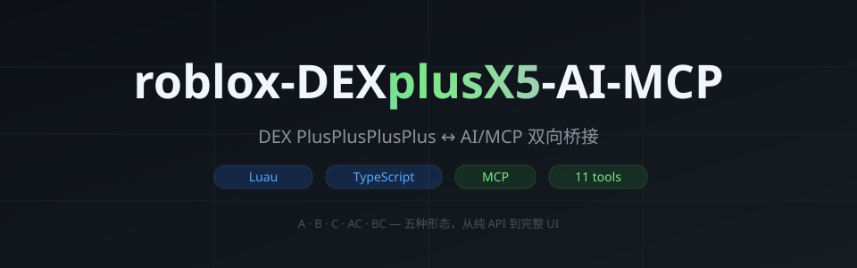

# roblox-DEXplusX5-AI-MCP

<p align="center">
  
</p>

<p align="center">
  <strong>DEX PlusPlusPlusPlus ↔ AI/MCP 双向桥接</strong><br/>
  <sub>让 Claude / Cursor 等 AI 客户端直接读写你的 DEX 调试会话</sub>
</p>

<p align="center">
  
</p>

---

## 这是什么

本 fork 在上游 [DEX++ (snmwdd/DexPlusPlusPlusPlus)](https://github.com/snmwdd/DexPlusPlusPlusPlus) 基础上，新增了一套 **AI/MCP 桥接**：

- 一个 **Node.js MCP 服务端**，暴露 11 个 `dex-*` 工具给 AI 客户端
- 一个 **执行器侧 Lua 轮询器**，连接服务端并执行任务
- 五种形态的 **DEX 桥接脚本**（A/B/C/AC/BC）

AI 能看到你在 DEX 里选中的对象，也能反过来驱动 DEX 跳转、读属性、反编译、改属性、执行 Luau。

## 快速开始

### 1. 起服务端

```bash
git clone https://github.com/986mn/roblox-DEXplusX5-AI-MCP.git
cd roblox-DEXplusX5-AI-MCP
bash abc/oneshot.sh
```

一条命令：装依赖 → 编译 → 起服务 → 打印执行器加载代码。

### 2. 执行器加载

```lua
getgenv().BridgeURL = "localhost:16384"  -- 或局域网 IP / Codespaces https 地址

loadstring(game:HttpGet(
  "https://raw.githubusercontent.com/986mn/roblox-DEXplusX5-AI-MCP/main/script.lua"
))()

loadstring(game:HttpGet(
  "https://raw.githubusercontent.com/986mn/roblox-DEXplusX5-AI-MCP/main/lua/dex_mcp_poller.lua"
))()
```

看到 `[DPP-MCP] injected` 和 `[DPP-POLL] connected` 就通了。

**详细部署（Codespaces / 本机 / 局域网）见 [DEPLOY.md](./DEPLOY.md)**

## 五种形态

| 版本 | 内容 | 适用 |
|---|---|---|
| **A** | 完整读写 API | 只要 API |
| **C** | 悬浮按钮 + 队列 | 只要 UI |
| **AC** | A + C 合并 | 完整功能，推荐 |
| **B** | 运行时包装器（含 A） | 用官方 DEX |
| **BC** | B + C | 官方 DEX + 按钮 |

### A — 完整读写 API

```lua
loadstring(game:HttpGet(".../abc/dex_mcp_A.lua"))()  -- 或已内置在 script.lua
local D = getgenv().DEX
D.Snapshot()  D.Select({...})  D.Tree(...)  D.Props(...)
D.Source(...)  D.SetProp(...)  D.Run(...)  D.App(...)
```

### C — 悬浮按钮

```lua
loadstring(game:HttpGet(".../abc/dex_mcp_C.lua"))()
-- 右下角 [→ MCP] 按钮：左键发送选中，右键打印队列，Ctrl+Shift+M 快捷键
```

### AC — 合并单文件

```lua
loadstring(game:HttpGet(".../abc/dex_mcp_AC.lua"))()
-- 同时获得 API + 按钮
```

### B / BC — 用官方 DEX

```lua
getgenv().DEX_URL = "https://raw.githubusercontent.com/snmwdd/DexPlusPlusPlusPlus/refs/heads/main/script.lua"
loadstring(game:HttpGet(".../abc/dex_mcp_BC.lua"))()
```

## 目录结构

```
server/                 MCP 服务端（TypeScript，11 个工具）
lua/dex_mcp_poller.lua 执行器轮询器
abc/                    五种形态脚本 + oneshot.sh + 配图
src/modules/DexMCP.lua DEX 桥接模块
script.lua              DEX 构建产物（已含 DexMCP）
.devcontainer/          Codespaces 自动部署 + 保活
```

## 文档

- [DEPLOY.md](./DEPLOY.md) — 部署（Codespaces / 本机 / 局域网）+ 排错
- [DexMCP.md](./DexMCP.md) — DEX API 详细说明
- [README.zh-CN.md](./README.zh-CN.md) — 中文版

## 安全

16384 端口无鉴权，允许任意 Luau 执行。绝不要暴露到公网。仅用于自建测试环境。

## License

MIT
